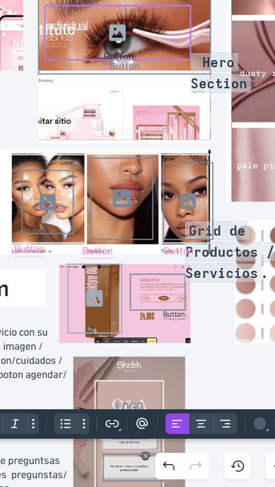

# Componentes — Studio Ash

> Guía: [Componentes](../evaluacion/guias/fase-2-specs/03-calco-de-componentes.md)

**Tablero en Whimsical:** [Studio Ash - Fase 2 Specs](https://whimsical.com/mau7/studio-ash-fase-2-specs-HzN1XTeTNqm14pEYUk9L4W)

| Componente | Referencia | Qué contiene | Qué necesidad resuelve |
|---|---|---|---|
| **1. Header / Navbar** | Landing / Global | Logo de Studio Ash, menú de navegación (Inicio, Servicios, FAQ, Contacto) y botón de acción. | Permite la navegación rápida por todo el sitio. |
| **2. Hero Section** | Landing | Título principal, subtítulo de propuesta de valor, imagen de impacto y botón de reserva. | Capta la atención inmediata del cliente y comunica la oferta principal. |
| **3. Grid de Servicios** | Tienda / Servicios | Tarjetas de servicios con imagen, descripción, tiempos, cuidados y precios. | Presenta la oferta comercial clara para incentivar la reserva. |
| **4. Tarjeta de Artículo (Q&A)** | Blog / Landing | Sección de preguntas frecuentes, recomendaciones y cuidados posteriores de pestañas. | Resuelve dudas comunes y posiciona la marca con autoridad profesional. |
| **5. Formulario de Citas** | Contacto | Sección sobre la Lash Artist (años de experiencia) y formulario para agendar/contactar. | Facilita la conversión directa de clientes y la captura de leads. |
| **6. Footer** | Landing / Global | Calificaciones con estrellas, testimonios de clientes, redes sociales y datos de contacto. | Otorga prueba social, confianza visual y enlaces finales. |
