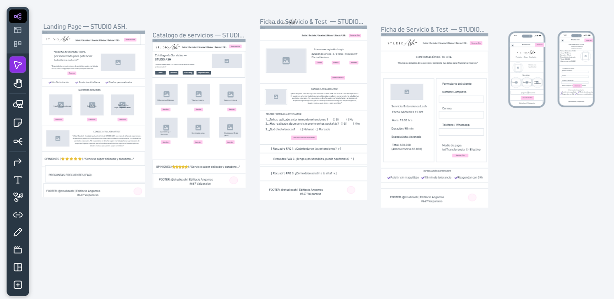

# Spec de diseño — Studio Ash

> Guía: [Spec de diseño](../evaluacion/guias/fase-2-specs/06-spec-de-diseno.md)

La spec de diseño tiene dos partes:

1. **[`DESIGN.md`](../DESIGN.md)** (en la raíz): tu design system, en el formato que Stitch importa.
2. **Este documento:** tus pantallas, escritas como prompts listos para pegar en Stitch.

**Wireframes en Whimsical:** [Studio Ash - Tablero de Wireframes](https://whimsical.com/mau7/S9JoCqAQKbX3B8ozgsEXpv)

> Guía de wireframes: [Wireframes](../evaluacion/guias/fase-2-specs/04-wireframes.md)

> [!NOTE]
> ### 📋 Estado de Entrega de Wireframes (6/6) — Información para la Profesora
>
> - **Enlace directo al tablero:** [https://whimsical.com/mau7/S9JoCqAQKbX3B8ozgsEXpv](https://whimsical.com/mau7/S9JoCqAQKbX3B8ozgsEXpv)
> - **Nivel de avance visual:** **6 wireframes finalizados** (100% completado: 4 vistas Web Desktop + 2 vistas Mobile Celular).
> - **Estado de especificación (prompts):** **6 de 6 pantallas completas** (100% redactadas y listas para Stitch a continuación).
>
> | N° | Pantalla / Vista | Formato | Estado en Whimsical | Estado de Prompt | Rol en el sitio |
> |:--:|:---|:---:|:---:|:---:|:---|
> | **1** | **Landing** | Web Desktop + Mobile | ✅ Completo | ✅ Listo | Home principal, propuesta de valor, hero y presentación. |
> | **2** | **Tienda / Servicios** | Web Desktop + Mobile | ✅ Completo | ✅ Listo | Catálogo de servicios y extensiones, filtros y tarifas. |
> | **3** | **Ficha de servicio** | Web Desktop | ✅ Completo | ✅ Listo | Detalle de aplicación, variantes, duración y botón de agendar. |
> | **4** | **Carrito / Reserva** | Web Desktop | ✅ Completo | ✅ Listo | Formulario de datos, resumen y confirmación de abono. |
> | **5** | **Blog / Q&A** | Web Desktop | ✅ Completo | ✅ Listo | Preguntas frecuentes y artículos de cuidado posterior. |
> | **6** | **Artículo** | Web Desktop | ✅ Completo | ✅ Listo | Lectura completa de recomendaciones y bioseguridad. |
>
> *Nota explicativa sobre la entrega:* Se completaron la totalidad de los 6 wireframes en Whimsical (4 pantallas en versión Web y 2 pantallas clave en versión Mobile para Celular: Landing y Tienda, respondiendo a la compra prioritaria desde smartphone de la proto-persona). En este documento se detallan además los prompts de las 6 pantallas con sus componentes definitivos para la etapa de generación en Stitch.



---

## Pantallas

### 1. Landing

```text
Pantalla: Landing de Studio Ash, versión desktop. Usa el design system del proyecto (DESIGN.md).
Objetivo: Presentar la propuesta de valor del studio de pestañas y cejas, captar la atención visual de las clientas y dirigir la reserva directa de citas.
Componentes, de arriba hacia abajo:
1. Navbar: Logotipo de Studio Ash, enlaces de navegación (Inicio, Servicios, FAQ, Contacto) y botón CTA button-primary "Agendar Cita".
2. Hero Section: Banner de portada con fotografía elegante en primer plano, titular h1 de impacto "Realza la belleza natural de tu mirada", bajada descriptiva y botón destacado button-primary "Reserva Tu Cita".
3. Grid de Servicios: Grilla de tarjetas card-service con servicios principales (Extensiones Clásicas 1x1 $28.000, Volumen Ruso $36.000, Lash Lifting + Tinte $22.000) con fotos de catálogo, tiempos de aplicación y botón button-secondary "Ver detalles".
4. Sección sobre la Lash Artist: Bloque "Conoce a tu Lash Artist" con fotografía profesional, años de experiencia certificada, protocolos de higiene y bioseguridad, e historia del estudio.
5. Footer: Testimonios con calificación de 5 estrellas, redes sociales (@studioash), datos de contacto y copyright.
```

---

### 2. Tienda / Servicios

```text
Pantalla: Tienda de servicios de Studio Ash, versión desktop. Usa el design system del proyecto (DESIGN.md).
Objetivo: Mostrar el catálogo completo de servicios y cuidados de pestañas con filtros claros de selección y opción de agendamiento rápido.
Componentes, de arriba hacia abajo:
1. Navbar: Menú global consolidado con logotipo, enlaces principales y botón de reserva/carrito.
2. Header de Sección: Titular h1 "Servicios y Tratamientos", bajada descriptiva y selector con chips de categoría: "Todos", "Pestañas", "Cejas", "Kits de Cuidado".
3. Grid de Productos / Servicios: Matriz de tarjetas de 3 columnas de card-service con imagen en alta calidad, duración estimada (ej. "90 min"), precio destacado, badge de categoría y botón button-primary "Agendar / Añadir".
4. Footer: Enlaces de navegación global, políticas de abono previo (50%), métodos de pago aceptados y contacto directo por WhatsApp.
```

---

### 3. Ficha de producto / Servicio

```text
Pantalla: Ficha de servicio de Studio Ash, versión desktop. Usa el design system del proyecto (DESIGN.md).
Objetivo: Detallar las especificaciones de un servicio específico (ej. Extensiones Volumen Híbrido) explicando el proceso, duración y cuidados antes de reservar.
Componentes, de arriba hacia abajo:
1. Navbar: Menú global de navegación.
2. Layout de Producto (2 columnas):
   - Izquierda: Galería de imágenes (foto principal de alta resolución y miniaturas con resultados antes/después).
   - Derecha: Titular h1 con el nombre del servicio, valoración en estrellas (5.0), precio ($32.000), duración de la sesión ("2 hrs"), selector de variante o efecto (Natural, Cat Eye, Open Eye) y botón button-primary "Seleccionar Fecha y Hora".
3. Pestañas Informativas: Acordeones / pestañas con "Cuidados Posteriores", "Política de Cancelación" y "Contraindicaciones (Piel sensible / Alergias)".
4. Footer: Pie de página estándar del sitio con canales de atención al cliente.
```

---

### 4. Carrito / Reserva

```text
Pantalla: Carrito y confirmación de cita de Studio Ash, versión desktop. Usa el design system del proyecto (DESIGN.md).
Objetivo: Permitir a la clienta revisar los servicios seleccionados, verificar fecha/hora y registrar el abono de reserva de manera transparente.
Componentes, de arriba hacia abajo:
1. Navbar: Navbar simplificado con indicador de pasos: 1. Selección -> 2. Datos personales -> 3. Abono y Confirmación.
2. Resumen de Reserva: Tabla resumen con el servicio seleccionado, fecha y hora asignada, duración estimada y desglose de valores: Total del servicio ($32.000), Abono de reserva requerido 50% ($16.000) y Saldo pendiente al momento de la cita ($16.000).
3. Formulario de Datos: Campos de texto para Nombre completo, WhatsApp de contacto, Email y área de notas para informar sensibilidades oculares o historial de alergias.
4. Botón de Pago: Botón destacado button-primary "Pagar Abono y Confirmar Cita".
5. Footer: Pie de página secundario con enlace de soporte directo y garantía de reserva segura.
```

---

### 5. Blog / Q&A

```text
Pantalla: Blog y sección Q&A de Studio Ash, versión desktop. Usa el design system del proyecto (DESIGN.md).
Objetivo: Ofrecer artículos educativos sobre el mantenimiento de extensiones de pestañas y resolver las preguntas frecuentes de las clientas para generar confianza.
Componentes, de arriba hacia abajo:
1. Navbar: Menú de navegación global.
2. Header de Blog: Titular h1 "Guías de Cuidado y Preguntas Frecuentes" con buscador de artículos y temas.
3. Grid de Preguntas Frecuentes (Q&A): Acordeones interactivos con las dudas más comunes (¿Cuánto dura una aplicación?, ¿Puedo usar máscara de pestañas?, ¿Qué pasa si tengo ojos sensibles?).
4. Grid de Artículos: Matriz de 3 columnas con tarjetas card-blog (imagen miniatura, categoría, título h3, resumen breve y tiempo estimado de lectura).
5. Footer: Pie de página global con enlaces a redes y botón directo para agendar.
```

---

### 6. Artículo

```text
Pantalla: Lectura de artículo del blog de Studio Ash, versión desktop. Usa el design system del proyecto (DESIGN.md).
Objetivo: Presentar una guía detallada sobre cuidados posteriores o tendencias de pestañas en un formato de lectura cómodo, pulcro y elegante.
Componentes, de arriba hacia abajo:
1. Navbar: Menú de navegación global.
2. Cabecera del Artículo: Título h1 de la entrada ("Guía de primeros auxilios: cómo cuidar tus extensiones las primeras 48 horas"), fecha de publicación, badge de autora ("Por Lash Artist certificada") e imagen de portada destacada.
3. Cuerpo del Texto: Columna central de lectura (max-width 720px) con subtítulos h2/h3, listas con viñetas de recomendaciones, recuadro destacado (callout) de advertencia sobre agua caliente y vapores, e imágenes ilustrativas del cepillado correcto.
4. CTA Final: Banner al cierre de lectura invitando a agendar una cita o adquirir el kit de cuidado post-tratamiento.
5. Footer: Pie de página estándar con enlaces y créditos de autoría.
```

---

## Versión mobile (para cada pantalla)

```text
Genera la versión mobile (375px de ancho) de esta pantalla siguiendo la sección Layout del design system:
- Menú hamburguesa desplegable en el Header que contiene los enlaces y el botón de agendar.
- Grillas de 2 y 3 columnas (Grid de Servicios, Blog y Layout de Producto) colapsadas a 1 sola columna vertical con espaciado consistente.
- Tipografías escaladas según la tabla mobile (h1 a 32px, h2 a 26px, cuerpo de texto a 14px).
- Botón principal de acción ("Agendar Cita" o "Pagar Abono") con estilo sticky fijo al pie de pantalla para acceso cómodo con el pulgar.
```
