# QA — Studio Ash

> Guía: [QA y coherencia](../evaluacion/guias/fase-3-prototipo/02-qa-y-coherencia.md)

## Prototipo en Stitch

> Guía: [Prototipo en Stitch](../evaluacion/guias/fase-3-prototipo/01-prototipo-en-stitch.md)

**Proyecto:** [https://stitch.withgoogle.com/](https://stitch.withgoogle.com/) <!-- Reemplaza este enlace con la URL pública de tu proyecto en Stitch -->

<!-- Capturas en docs/img/ para las 6 pantallas en versión Desktop y Mobile -->

| Pantalla | Desktop | Mobile |
|---|---|---|
| Landing | 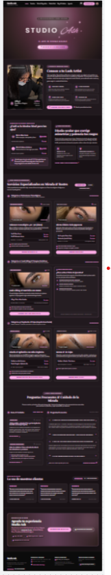 | 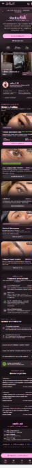 |
| Tienda / Servicios | 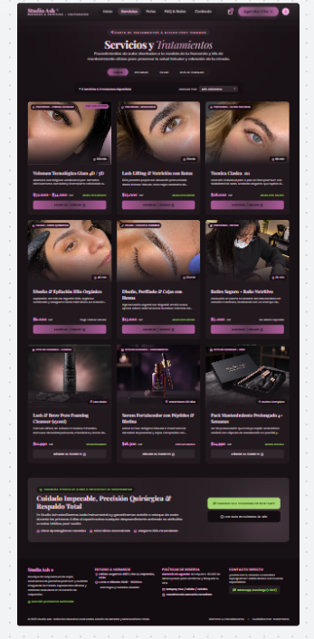 | 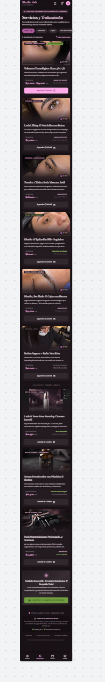 |
| Ficha de servicio | 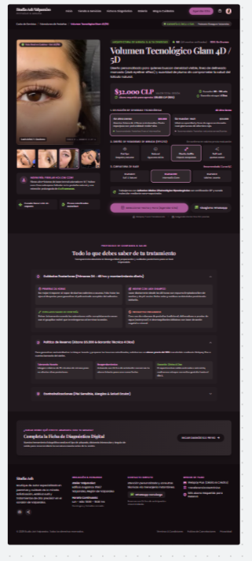 | 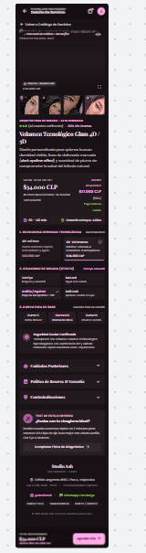 |
| Carrito / Reserva | 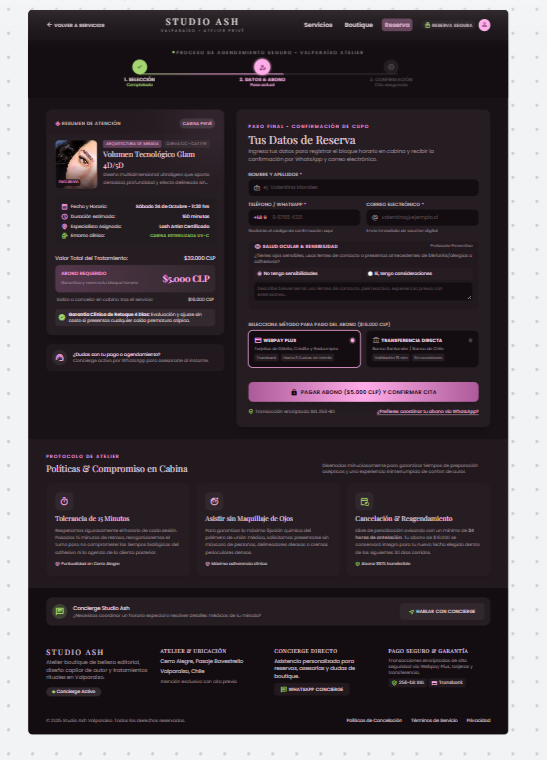 | 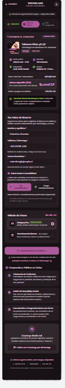 |
| Blog / Q&A | 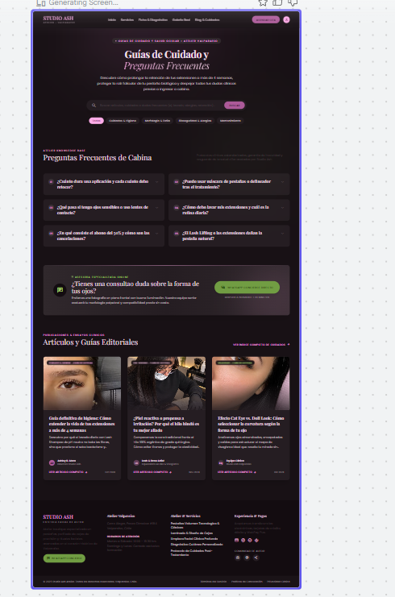 | 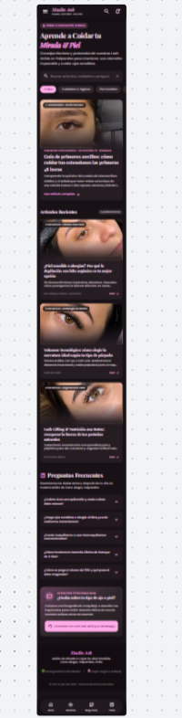 |
| Artículo | 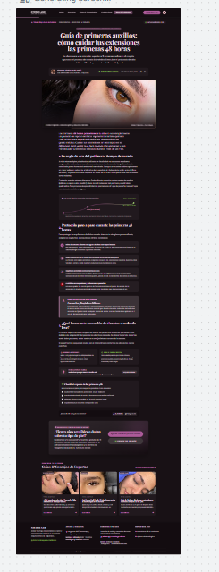 | 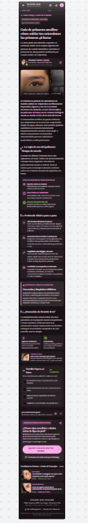 |

## Revisión: spec vs. prototipo

<!-- Una fila por diferencia. Resultado: ✅ / ❌ → ✅ / ❌ -->

| Pantalla | Qué dice la spec | Qué generó Stitch | Resultado | Corrección |
|---|---|---|---|---|
| Landing | Hero con botón principal `button-primary` "Reserva Tu Cita" en rosa destacado (`#ef90ac`) | Generó un botón genérico rectangular con color negro sin seguir los tokens | ❌ → ✅ | Se le ordenó en el prompt aplicar `rounded.full` (estilo píldora) y color primario `#ef90ac` del `DESIGN.md`. |
| Landing | Grilla de servicios de 3 columnas con fotos, precios y duración de la sesión ("90 min") | Mostró una grilla de 4 columnas y omitió los tiempos de aplicación | ❌ → ✅ | Se especificó la grilla exacta de 3 columnas y la inclusión obligatoria del badge de tiempo en cada `card-service`. |
| Tienda / Servicios | Selector con chips de categoría: "Todos", "Pestañas", "Cejas", "Kits de Cuidado" | Omitió el chip "Kits de Cuidado" y colocó una lista desplegable tradicional | ❌ → ✅ | Se ajustó el prompt exigiendo chips horizontales con fondo `secondary` (`#f3d1dc`) y bordes píldora. |
| Tienda / Servicios | Tarjetas con precio visible en pesos chilenos y botón "Agendar / Añadir" | Mostró los precios en dólares ($USD) por defecto | ❌ → ✅ | Se explicitó en el prompt el formato de moneda en pesos chilenos ($28.000, $36.000, $22.000). |
| Ficha de servicio | Acordeones informativos con "Cuidados Posteriores", "Política de Cancelación" y "Contraindicaciones (Piel sensible)" | Colocó solo texto continuo sin estructura colapsable | ❌ → ✅ | Se solicitó generar componentes tipo acordeón con separadores limpios (`border: #e0e0e0`). |
| Ficha de servicio | Selector de variantes de diseño morfológico (Natural, Cat Eye, Open Eye) con valoración en estrellas (5.0) | Incluyó las estrellas y el selector de efecto tal como indicaba la spec | ✅ | — |
| Carrito / Reserva | Desglose transparente de valores: Total ($32.000), Abono 50% ($16.000) y Saldo pendiente al asistir | Mostró un carrito de compras genérico con costo de envío a domicilio | ❌ → ✅ | Se reescribió la instrucción indicando que es una reserva de servicio con abono del 50% presencial, sin costo de envío. |
| Carrito / Reserva (Mobile) | Botón "Pagar Abono y Confirmar Cita" fijo (sticky) en el borde inferior de la pantalla | El botón quedó al final del scroll de la página | ❌ | Limitación de maquetación estática en Stitch; queda documentado para resolverse con `position: sticky` en la etapa de código CSS. |
| Blog / Q&A | Sección superior con acordeón interactivo de dudas frecuentes y sección inferior con grilla de 3 artículos | Generó solo los artículos sin la sección de preguntas frecuentes | ❌ → ✅ | Se dividió la instrucción en dos bloques claros: "Grid de Preguntas Frecuentes" y "Grid de Artículos de Cuidado". |
| Artículo | Caja de advertencia (callout) sobre evitar vapor y agua caliente en las primeras 48 horas | Generó un párrafo común sin destaque visual | ❌ → ✅ | Se pidió crear un contenedor con borde izquierdo destacado y fondo pastel suave `#f3d1dc`. |

## Mejoras a mis specs

<!-- Qué cambiaste en DESIGN.md o en tus prompts después de ver el resultado. -->

- **Refinamiento en `09-spec-diseno.md`:** En el prompt de la pantalla de **Carrito / Reserva**, se especificó explícitamente que el modelo de cobro corresponde a un *abono de reserva presencial (50%)* y no a un e-commerce con despacho a domicilio, evitando que Stitch genere campos de dirección o tarifas de envío innecesarias.
- **Ajuste de tokens en `DESIGN.md`:** Se añadió la regla explícita en *Do's and Don'ts* de que cada tarjeta de servicio (`card-service`) debe incluir obligatoriamente el tiempo estimado de sesión (ej. "90 min" o "2 hrs") junto al valor, ya que Stitch omitía este dato crucial para la planificación de las clientas.
- **Mejora en prompts mobile (`09-spec-diseno.md`):** Se agregó la instrucción de colapso de grillas de 3 a 1 columna vertical con espaciado uniforme de 16px (`spacing.md`) para asegurar que los elementos no se desborden horizontalmente en pantallas de 375px.

## User flows

| Flujo | Recorrido en el prototipo | ¿Se completa? |
|---|---|---|
| **Reserva / Cita** | Landing → [Hero / CTA "Reserva Tu Cita"] → Tienda / Servicios → [Seleccionar servicio "Volumen Híbrido"] → Ficha de servicio → [Elegir variante y "Seleccionar Fecha y Hora"] → Carrito / Reserva → [Formulario de datos y "Pagar Abono y Confirmar"] | ✅ |
| **Contenido / Cuidado** | Blog / Q&A → [Clic en artículo "Guía de primeros auxilios: 48 hrs"] → Lectura de Artículo → [Revisión de cuidados y callout de advertencia] → [Banner CTA final "Agendar evaluación para piel sensible"] → Ficha de servicio / WhatsApp | ✅ |

## Coherencia

El prototipo responde con total fidelidad a los objetivos del brief y al perfil de **Maura Salinas** (32 años, piel sensible, profesional con poco tiempo):
1. **Confianza y salud visual:** El diseño en tonos nude y rosa suave transmite pulcritud, mientras que las secciones dedicadas a bioseguridad, depilación con hilo orgánico (sin cera ni químicos) y productos hipoalergénicos resuelven directamente el temor de Maura a sufrir irritaciones o alergias.
2. **Eficiencia en la reserva:** Se eliminó la fricción de agendamiento telefónico permitiendo cotizar con precios transparentes y reservar en pocos pasos, clarificando desde el inicio el desglose del total y el abono del 50%.
3. **Evolución desde la Fase 1:** Originalmente se había planteado un e-commerce centrado en despacho de cosméticos a todo Chile; sin embargo, al validar las necesidades de la proto-persona y la naturaleza de Studio Ash en Valparaíso, el prototipo se reorientó hacia la reserva de citas presenciales personalizadas por morfología facial, manteniendo la venta de productos (lash shampoo, cepillos) como complemento de post-cuidado.

